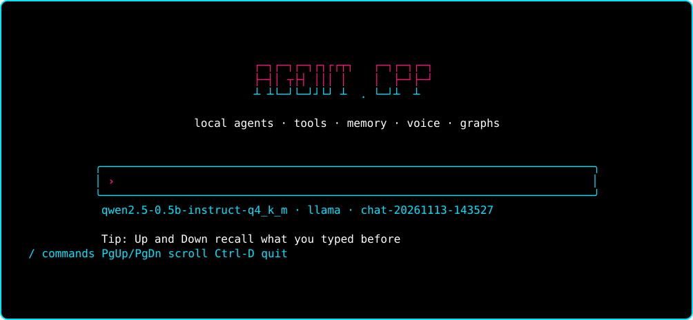
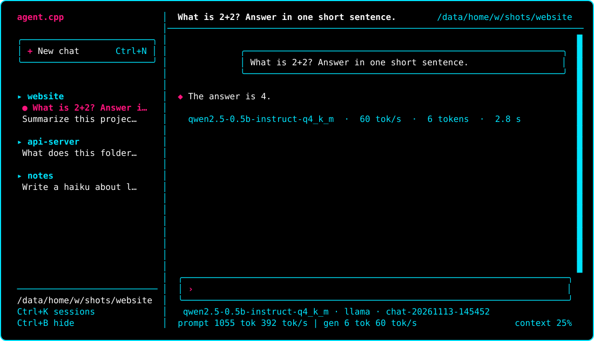

# agent.cpp

<p align="center"></p>

**Run AI agents on your own machine, from one small C++ library or one command.**

agent.cpp is a local-first agent runtime. Chat with a model that can read your files and run commands, transcribe speech,
speak, draw, turn a picture into a 3D mesh, or wire all of that into a graph that runs on a schedule. Nothing leaves your
computer, and you do not need Python, Node or a cloud account.

<p align="center"></p>

That is the real chat screen (Qwen2.5-0.5B on a 4-core CPU), laid out like a chat website: your sessions on the left, grouped by project (pick one and the agent switches to that folder), the conversation in the middle with the model and speed under every answer, and the input at the bottom.

> Status: pre-1.0. Flags, APIs and file formats can still change. Targets Windows 11 and Linux.

## What you can do with it

| I want to | Use | Engine |
|---|---|---|
| chat with tools, vision and long context | `agent` | llama.cpp |
| transcribe audio | `agent task asr --file talk.wav` | audio.cpp (Parakeet, Moonshine, CrisperWhisper) |
| turn text into speech | `agent task tts --text "Hello"` | audio.cpp (pocket-tts, supertonic-3) |
| find speech in a recording, tell speakers apart | `agent task vad` / `diarize` | audio.cpp |
| talk to the agent by voice | `agent voice` | audio.cpp + llama.cpp |
| generate or edit images, make short videos | `agent task image_gen` | stable-diffusion.cpp |
| make a 3D mesh from a picture | `agent task mesh_gen` | TRELLIS.2 |
| run any ONNX model | `agent task generic` | ONNX Runtime |
| embed, rerank, classify | `agent task embed` / `rerank` / `classify` | llama.cpp |
| run a repeatable multi-step workflow | `agent run flow.json` | any |

Voice is a pipeline (speech recognition, then the model, then speech synthesis). There is no single speech-to-speech model
engine yet.

## Install

**Linux** (x86_64, aarch64):

```sh
curl -fsSL https://agent.qozu.fyi/install.sh | sh
```

**Windows** (x64, arm64), in PowerShell:

```powershell
irm https://agent.qozu.fyi/install.ps1 | iex
```

The script picks the archive for your machine (the Vulkan build (Intel, AMD and Arm GPUs) when a Vulkan driver is present, else the CPU build; `AGENT_VARIANT=cpu|vulkan` overrides), checks its SHA-256 against the release's `SHA256SUMS`, and installs to `~/.local/share/agent-cpp` (Linux) or
`%LOCALAPPDATA%\Programs\agent-cpp` (Windows). Then run `agent setup`. `agent update` keeps it current; it checks the release's signature.
The archives are on the [releases page](https://github.com/amitverma-cf/agent.cpp/releases). Linux needs glibc 2.39 or newer. Linux and Windows on x86_64 (Intel, AMD) and
aarch64 (Arm) are published; CUDA, ROCm and macOS builds are not.

**From source.** You need CMake 3.21+, Ninja and a C++20 compiler (MSVC 2022, GCC 12+ or Clang 15+). Windows details and OpenSSL are in
[docs/getting-started.md](docs/getting-started.md).

```sh
git clone --recurse-submodules https://github.com/amitverma-cf/agent.cpp
cd agent.cpp
cmake -B build -G Ninja
cmake --build build
cmake --install build --prefix ~/agent-cpp
```

Every engine is built by default and installed as its own plugin. Switch one off with its option (`-DAGENT_ENGINE_SDCPP=OFF`):

| Engine | Option | Built by default when |
|---|---|---|
| llama.cpp | `AGENT_ENGINE_LLAMA` | always |
| ONNX Runtime | `AGENT_ENGINE_ONNX` | always (downloads ONNX Runtime at configure time) |
| audio.cpp | `AGENT_ENGINE_AUDIOCPP` | the `vendor/audio.cpp` submodule is checked out |
| stable-diffusion.cpp | `AGENT_ENGINE_SDCPP` | the `vendor/stable-diffusion.cpp` submodule is checked out |
| TRELLIS.2 | `AGENT_ENGINE_TRELLIS` | the `vendor/trellis2cpp` submodule is checked out (CPU; no CUDA needed) |

Your own application ships only the engines it names (see below), so having them all built costs your users nothing.

## First run

```sh
agent setup      # picks a home folder, finds your hardware and engines, suggests and downloads a model
agent            # opens the chat
```

After the install script, `agent` is on your PATH (open a new terminal on Windows). `agent setup` offers a model that fits your machine, so
there is no separate download step; `agent model pull NAME` adds more. Built from source, run `./build/agent` (`.\build\agent.exe` on Windows) instead of `agent`. `agent --help` lists every command, and `agent <command> --help` explains one.

## The command line

| Command | What it does |
|---|---|
| `agent` | the full-screen chat (same as `agent chat`; `--plain` for a pipe-friendly mode) |
| `agent setup` | first-time setup: home folder, hardware check, engines, first model |
| `agent model pull\|ls\|rm\|search\|info` | download from Hugging Face, list, remove, browse tested models |
| `agent task <capability>` | run one engine capability once (`asr`, `tts`, `image_gen`, ...) |
| `agent run <graph.json>` | run a declarative graph; resumable |
| `agent voice` | microphone, speech recognition, model, speech synthesis, speaker |
| `agent engine ls\|add\|pull\|rm` | manage engine plugins |
| `agent skill`, `agent mcp` | add skills (`SKILL.md`) and MCP servers |
| `agent sandbox`, `agent secret` | folders tools may use; API keys in the OS credential store |
| `agent init`, `agent doctor`, `agent clean` | project folder, what is installed and disk use, cleanup |

Typing `/` (or pressing Ctrl+P) in the chat opens a command palette (`/model`, `/image`, `/open`, `/stats`, `/doctor`, `/setup`, `/clear`, `/help`, `/exit`); Tab completes, Up and Down recall earlier messages, PgUp and PgDn scroll, Ctrl+K picks another session and Ctrl+N starts a new chat.

 Full reference: [docs/cli.md](docs/cli.md).

## Use it as a library

Install it (see above), then link it from CMake:

```cmake
find_package(agent-cpp REQUIRED COMPONENTS llama)
target_link_libraries(my_app PRIVATE agent-cpp::agent)
agent_deploy_engines(my_app llama)     # copies the llama engine next to my_app after each build, and into install()
```

```cpp
#include <agent-cpp/agent.hpp>
#include <cstdio>

int main() {
    agent::AgentRuntime runtime;

    auto session = agent::open_session(agent::engines::llama, "models/qwen2.5-0.5b-instruct-q4_k_m.gguf");
    if (!session.ok) return std::fprintf(stderr, "%s\n", session.error.message.c_str()), 1;

    agent::Conversation chat;
    auto reply = agent::run_turn(session.value, chat, "Say hi in five words.", true,
                                 [](std::string_view token, void *) { std::fwrite(token.data(), 1, token.size(), stdout); });
    return reply.ok ? 0 : 1;
}
```

- **Choosing engines.** `agent::engines::llama`, `audiocpp`, `sdcpp`, `trellis` and `onnx` name the engines that ship with agent.cpp. The
  program finds the plugin in its own `engines/` folder at run time. `agent_deploy_engines` fills that folder with just the engines you
  name, so engines you do not use never ship with your app.
- **More than one model file.** `agent::open_session(agent::engines::audiocpp, {{"asr.model", "asr.gguf"}, {"tts.model", "tts.gguf"}})`.
- **One-shot tasks.** `agent::transcribe`, `agent::speak` and `agent::draw` for speech and images.
- **Full control.** `agent::engine_config` and `agent::init` take a complete `Config`: tools, the permission gate, sandbox settings,
  memory, process isolation ([the guide](docs/guide.md)).
- **Leave out what you do not use.** Graphs, MCP, RAG and the model registry are build options
  ([choosing the parts you use](docs/guides/choosing-parts.md)).

The library has one header, no exceptions (`Result<T>` everywhere), no virtual calls, and works from C through
[`agent_c.h`](docs/api/c-api.md). Start with [the library guide](docs/guides/getting-started-library.md); runnable programs for chat,
tools, graphs, RAG, images and speech are in [examples/](examples/README.md).

## Safety

Tools and engines run in an OS sandbox: Landlock and seccomp on Linux, an AppContainer on Windows 11. Engines run in their
own process, so a crash fails one turn, not your program. Running a command, deleting or moving a file asks you first, unless
you pass `--yes`. `--no-sandbox` turns the sandbox off. See [docs/security-sandbox.md](docs/security-sandbox.md).

## Documentation

[Documentation index](docs/index.md) · [Getting started](docs/getting-started.md) · [CLI reference](docs/cli.md) ·
[C++ API](docs/api.md) · [C API](docs/api/c-api.md) · [Architecture](docs/architecture.md) ·
[Writing an engine](docs/guides/writing-an-engine.md) · [Writing a tool](docs/guides/writing-a-tool.md) ·
[Writing a graph](docs/guides/writing-a-graph.md) · [A voice assistant](docs/guides/voice-assistant.md) · [Choosing the parts you use](docs/guides/choosing-parts.md) ·
[Benchmarks](docs/benchmarks.md) · [How it compares](docs/comparison.md) · [Examples](examples/README.md)

Build options, packaging and the source layout are in [docs/getting-started.md](docs/getting-started.md) and
[docs/packaging.md](docs/packaging.md). Contributing: [CONTRIBUTING.md](CONTRIBUTING.md). Security reports: [SECURITY.md](SECURITY.md).

## License

[MIT](LICENSE)
