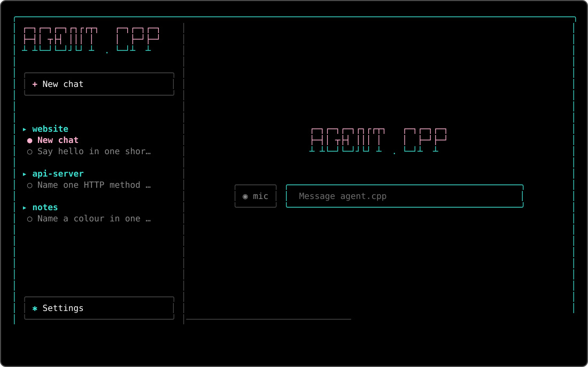

<p align="center"></p>

<h1 align="center">agent.cpp</h1>

<p align="center">
  <strong>A local-first agent runtime in C++20.</strong><br/>
  Chat with a model that can read your files and run commands, transcribe speech, speak, draw and make 3D meshes, all offline.
</p>

<p align="center">
  <a href="https://agent.qozu.fyi">Website</a>
  ·
  <a href="docs/index.md">Docs</a>
  ·
  <a href="https://github.com/amitverma-cf/agent.cpp/releases">Releases</a>
  ·
  <a href="https://github.com/amitverma-cf/agent.cpp/issues">Issues</a>
  ·
  <a href="https://github.com/sponsors/amitverma-cf">Sponsor</a>
</p>

<p align="center">
  <a href="https://github.com/amitverma-cf/agent.cpp/releases"></a>
  <a href="LICENSE"></a>
  
  
  <a href="https://github.com/sponsors/amitverma-cf"></a>
</p>

<p align="center">
  <a href="https://github.com/amitverma-cf/agent.cpp/stargazers"></a>
  <a href="https://github.com/amitverma-cf/agent.cpp/network/members"></a>
  <a href="https://github.com/amitverma-cf/agent.cpp/issues"></a>
  <a href="https://github.com/amitverma-cf/agent.cpp/releases"></a>
</p>

## Highlights

- **Local.** Prompts, files and voice recordings never leave the computer. Qwen, Llama, Gemma and any other GGUF model.
- **Modular.** One folder holds everything. llama.cpp, audio.cpp and onnxruntime come from their own releases at pinned versions, with
  SHA-256 checks, and the GPU backend (CUDA, ROCm, Vulkan, Metal) follows the machine.
- **More than chat.** Speech in and out, image and video generation, image to 3D, MCP servers, skills, scheduled graphs.
- **Safe by default.** Commands and file changes ask first and run in an OS sandbox.
- **A C++ library too.** One header, no exceptions, no virtual calls, no allocation in the per-turn path. The core adds under a
  microsecond per turn ([benchmarks](docs/benchmarks.md)).

## Install

**Linux and macOS:**

```sh
curl -fsSL https://agent.qozu.fyi/install.sh | sh
```

**Windows** (PowerShell):

```powershell
irm https://agent.qozu.fyi/install.ps1 | iex
```

The installer asks for one folder (default `~/.agent.cpp`, stored as the environment variable `AGENT_HOME`), installs the program, then
offers the engines (llama, audiocpp, onnx, sdcpp, trellis), the runtimes (bun, uv, node, pnpm, nub) and a first model. Everything is
downloaded for this machine at the version the release pins, and the GPU backend follows the driver found. Later: `agent engine pull NAME`,
`agent runtime install NAME`, `agent update`, `agent uninstall`.

## Supported platforms

| | Supported |
|---|---|
| Linux | x86_64 and aarch64, glibc 2.39 or newer |
| Windows 11 | x64 and arm64 |
| macOS | Apple silicon and Intel, macOS 14 or newer |

The installer offers what exists for the machine and says why anything is missing.

| Engine | Linux x86_64 | Linux aarch64 | Windows x64 | Windows arm64 | macOS arm64 |
|---|---|---|---|---|---|
| llama (chat, embeddings, rerank, vision, decision models) | CPU, Vulkan, CUDA 12 / 13, ROCm | CPU, Vulkan, CUDA 13 | CPU, Vulkan, CUDA 12 / 13, ROCm | CPU, Vulkan, CUDA 13 | Metal |
| onnx | yes | yes | yes | yes | yes |
| audiocpp (speech) | CPU, Vulkan, CUDA; glibc 2.43 or newer | no | CPU, Vulkan, CUDA | no | Metal |
| sdcpp (images, video), trellis (3D) | CPU | CPU | CPU | no | no |

stable-diffusion.cpp and TRELLIS.2 publish no library, so agent.cpp builds those two plugins. Intel macOS has llama and audiocpp.
Raspberry Pi and Android are not supported yet.

## Chat

```sh
agent
```

Sessions are grouped by project folder. The bottom bar shows CPU, RAM, the loaded model and context use, and the mic box starts voice input.

| Key | Action |
|---|---|
| `/` or `Ctrl+P` | command palette: `/model`, `/image`, `/open`, `/stats`, `/doctor`, `/clear`, `/help` |
| `Ctrl+N`, `Ctrl+K` | new chat, switch session |
| `Ctrl+B` | hide or show the sidebar |
| `F1` | every shortcut; **Settings > Shortcuts** rebinds them |
| `Esc` | stop an answer in progress |

Running a command, or deleting or moving a file, always asks first. Tools run inside an OS sandbox (Landlock and seccomp on Linux, an
AppContainer on Windows 11).

## More than chat

Every capability is one command, and all of them run offline.

| Goal | Command |
|---|---|
| Talk to the agent by voice | `agent voice` |
| Transcribe a recording | `agent task asr --file talk.wav` |
| Read text aloud | `agent task tts --text "Hello"` |
| Generate or edit an image, make a short video | `agent task image_gen` |
| Turn a picture into a 3D mesh | `agent task mesh_gen` |
| Run a repeatable workflow, resumable | `agent run flow.json` |
| Add models, MCP servers and skills | `agent model pull NAME`, `agent mcp`, `agent skill` |
| Check the installation, free disk space | `agent doctor`, `agent clean` |
| Remove agent.cpp and its data folder | `agent uninstall` (`--keep-data` keeps the models and conversations) |

`agent --help` lists every command. The full reference is [docs/cli.md](docs/cli.md).

## Embed it in a C++ program

```cpp
#include <agent-cpp/agent.hpp>

int main() {
    agent::AgentRuntime runtime;
    auto session = agent::open_session(agent::engines::llama, "models/qwen2.5-0.5b-instruct-q4_k_m.gguf");
    if (!session.ok) return 1;
    agent::Conversation chat;
    return agent::run_turn(session.value, chat, "Say hi in five words.").ok ? 0 : 1;
}
```

Engines run in the calling process by default; `"isolation": "process"` puts one in a sandboxed host. Start with the
[library guide](docs/guides/getting-started-library.md). The API is documented under [docs/api.md](docs/api.md), and runnable programs
are in [examples/](examples/README.md).

## Build from source

Requires CMake 3.21+, Ninja and a C++20 compiler (MSVC 2022, GCC 12+ or Clang 15+).

```sh
git clone --recurse-submodules https://github.com/amitverma-cf/agent.cpp
cd agent.cpp
cmake -B build -G Ninja
cmake --build build
ctest --test-dir build --output-on-failure
./build/agent
```

Windows prerequisites and build options: [docs/getting-started.md](docs/getting-started.md).

## Documentation

| Topic | Page |
|---|---|
| Using the `agent` command | [CLI reference](docs/cli.md), [getting started](docs/getting-started.md), [workspace layout](docs/workspace.md), [voice assistant](docs/guides/voice-assistant.md), [GPU support](docs/gpu.md) |
| Embedding the library | [library guide](docs/guides/getting-started-library.md), [usage guide](docs/guide.md), [API reference](docs/api.md), [C API](docs/api/c-api.md), [choosing parts](docs/guides/choosing-parts.md) |
| Extending | [writing an engine](docs/guides/writing-an-engine.md), [a tool](docs/guides/writing-a-tool.md), [a graph](docs/guides/writing-a-graph.md) |
| Background | [architecture](docs/architecture.md), [packaging](docs/packaging.md), [sandbox](docs/security-sandbox.md), [benchmarks](docs/benchmarks.md), [comparison](docs/comparison.md) |

Everything is indexed in [docs/index.md](docs/index.md). Contributing: [CONTRIBUTING.md](CONTRIBUTING.md). Security reports: [SECURITY.md](SECURITY.md).

## Support

Questions and bugs go to [issues](https://github.com/amitverma-cf/agent.cpp/issues). If agent.cpp is useful to you, a star helps, and
[sponsoring](https://github.com/sponsors/amitverma-cf) supports its development.

## License

[MIT](LICENSE)
